# 💊 MedLens

### Photo in, voice out: AI that reads your medicines and speaks to you

MedLens helps elderly and low-literacy patients understand their medicines. Take a photo of a medicine box, strip, or prescription, and MedLens uses Google Gemini to read it, then **speaks the instructions aloud in English or Urdu**, warns about dangerous combinations, and **rings an alarm with a voice reminder** at every dose time. A personal dashboard shows today's progress and weekly adherence, all inside a calm, eye-friendly, animated medical interface that adapts to phone and PC.

> **"Our AI knows when it doesn't know."** If a photo is unclear, MedLens does not guess. It asks the patient to confirm with their pharmacist.


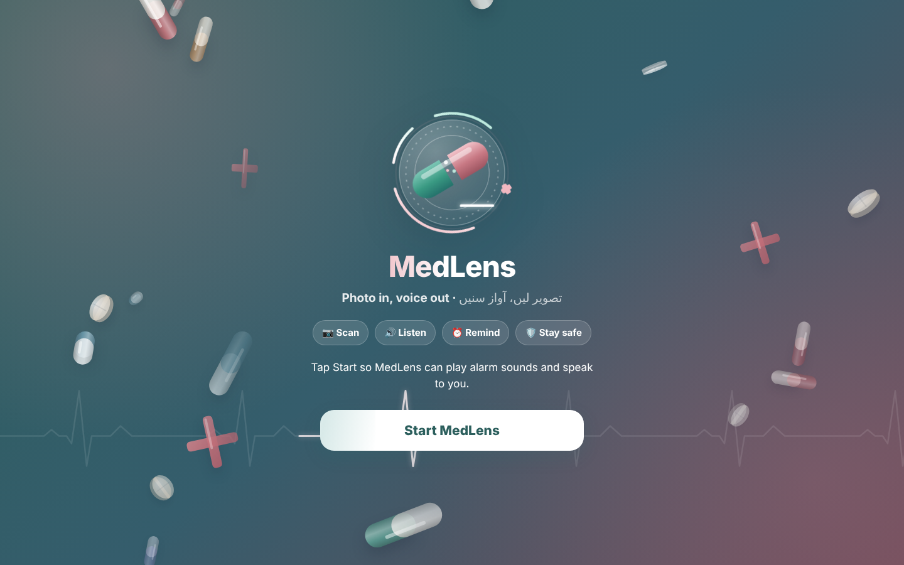

---

## 📌 Table of contents

1. [Problem statement](#-problem-statement)
2. [Our solution](#-our-solution)
3. [Screenshots](#-screenshots)
4. [Key features](#-key-features)
5. [Design and user experience](#-design-and-user-experience)
6. [How it works](#-how-it-works)
7. [System architecture](#-system-architecture)
8. [Data model (ERD)](#-data-model-erd)
9. [Technology stack](#-technology-stack)
10. [Getting started](#-getting-started)
11. [Using the app](#-using-the-app)
12. [Responsible AI and safety](#-responsible-ai-and-safety)
13. [Evaluation](#-evaluation)
14. [Real-world impact](#-real-world-impact)
15. [Limitations](#-limitations)
16. [Roadmap](#-roadmap)
17. [Team](#-team)
18. [Disclaimer](#-disclaimer)

---

## ❗ Problem statement

Many patients, especially elderly people and people with low literacy, **cannot read the small print on medicine packaging or the handwriting on prescriptions**. Instructions are often in a language they don't read well. As a result they:

- take the wrong dose or take it at the wrong time,
- forget doses entirely,
- take two brands that contain the **same active ingredient** without knowing it,
- combine medicines that are **dangerous together**.

Doctors and pharmacists are busy, and family members aren't always there to help. These patients need a tool that works **without reading, typing, or English**.

## 💡 Our solution

MedLens turns a single photo into clear, spoken, personalised guidance:

| Step | What happens |
|---|---|
| 🔐 **Log in** | The patient creates a profile with a 4-digit PIN. The **dashboard opens first** after login. |
| 📷 **Scan** | The patient photographs a medicine box, strip, or prescription using the **Scan** button (sidebar on PC, raised button in the bottom menu on phones). |
| ✨ **Read** | Gemini (vision) extracts name, generic name, strength, dose, frequency, timing and food instructions as **structured JSON**. |
| 🛡️ **Check** | Rule-based code (not the AI) checks for drug interactions, duplicate ingredients, allergies, and low-confidence readings. |
| 🔊 **Explain** | A picture schedule (☀️ 🌤️ 🌙) is shown and the instructions are spoken in **English or Urdu**. |
| ⏰ **Remind** | Reminders are created automatically. At dose time the app rings, shows a full-screen alert, and says: *"It's time to take your medicine."* / *"آپ کی دوا لینے کا وقت ہو گیا ہے۔"* |
| 📊 **Track** | The dashboard shows the next dose, today's progress, weekly adherence, and safety alerts. |

## 🖼️ Screenshots

| Start page (animated logo) | Login |
|---|---|
|  | 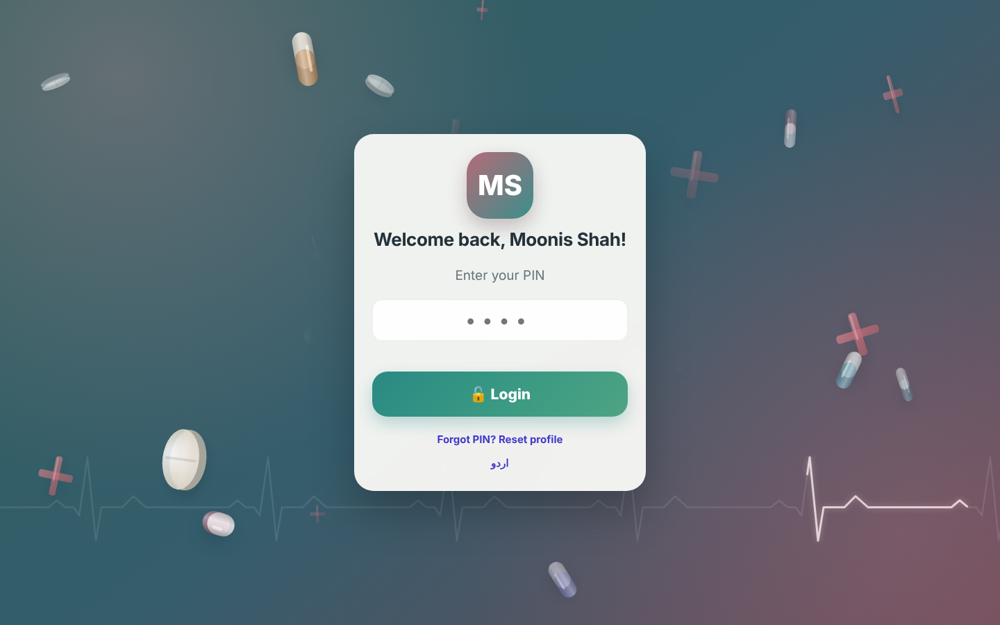 |

| Dashboard (opens first) | Dashboard in Urdu |
|---|---|
| 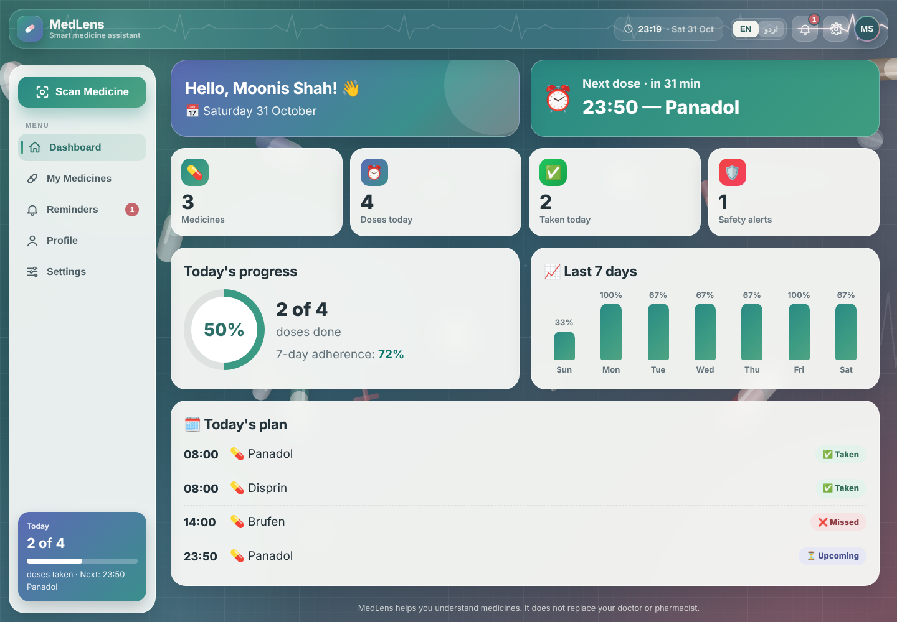 | 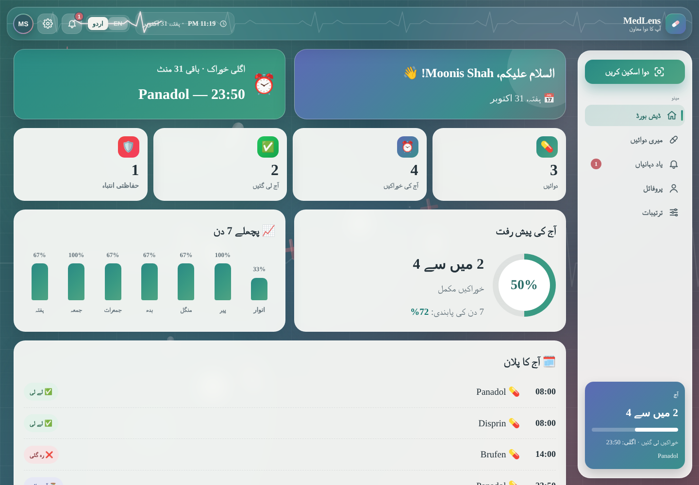 |

| Scan result + "refuses to guess" | My Medicines + safety warning |
|---|---|
| 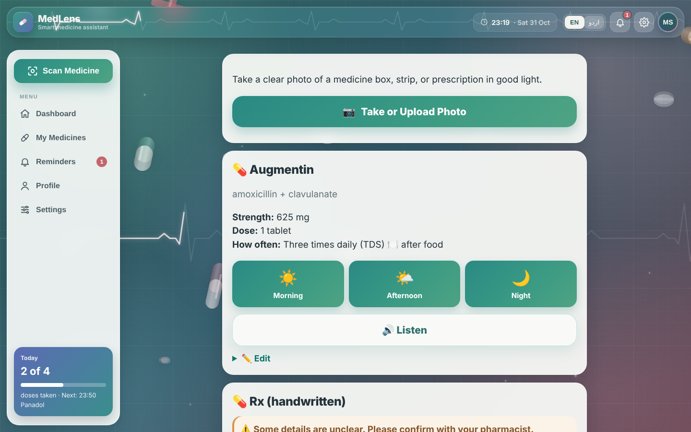 | 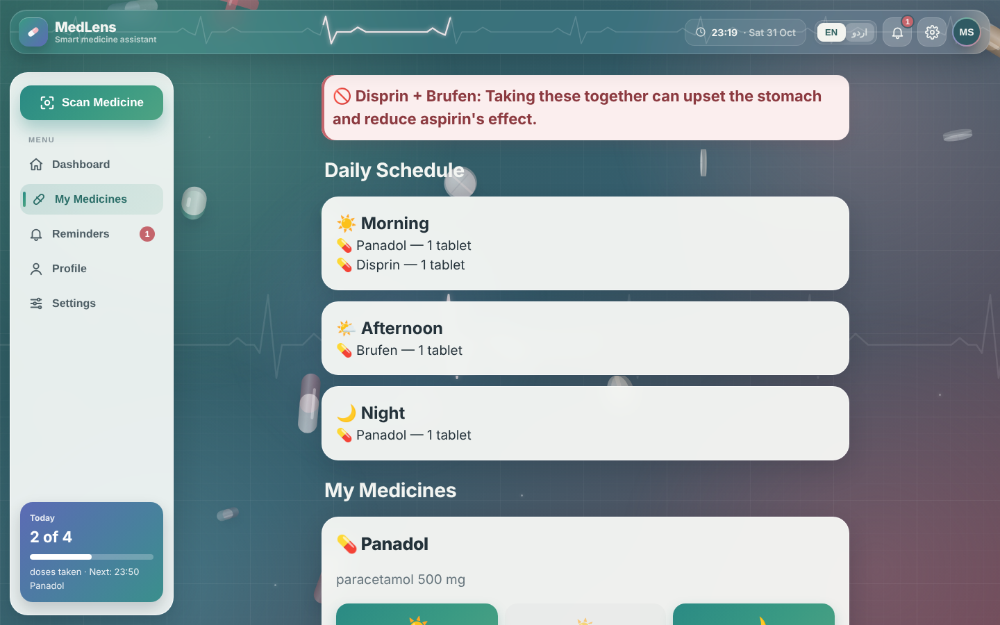 |

| Reminders | Alarm with voice |
|---|---|
| 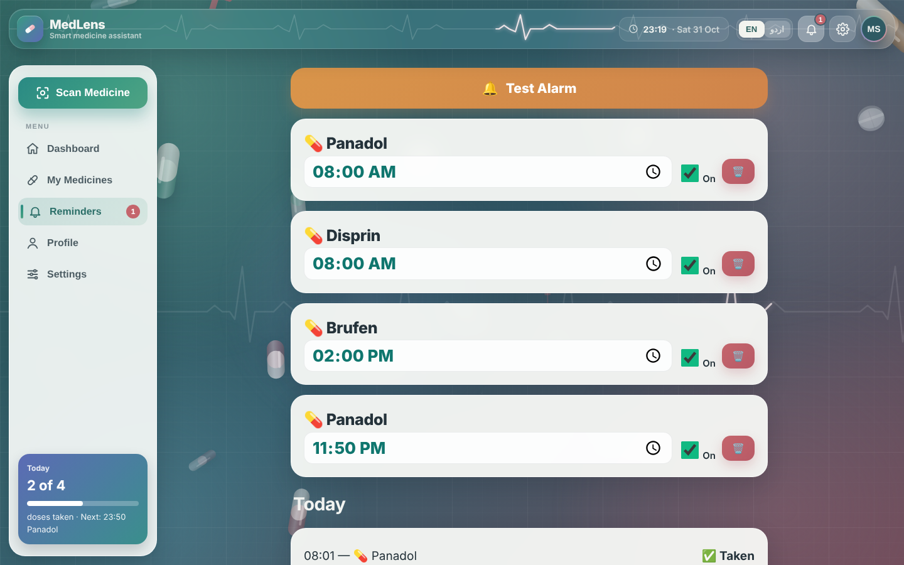 | 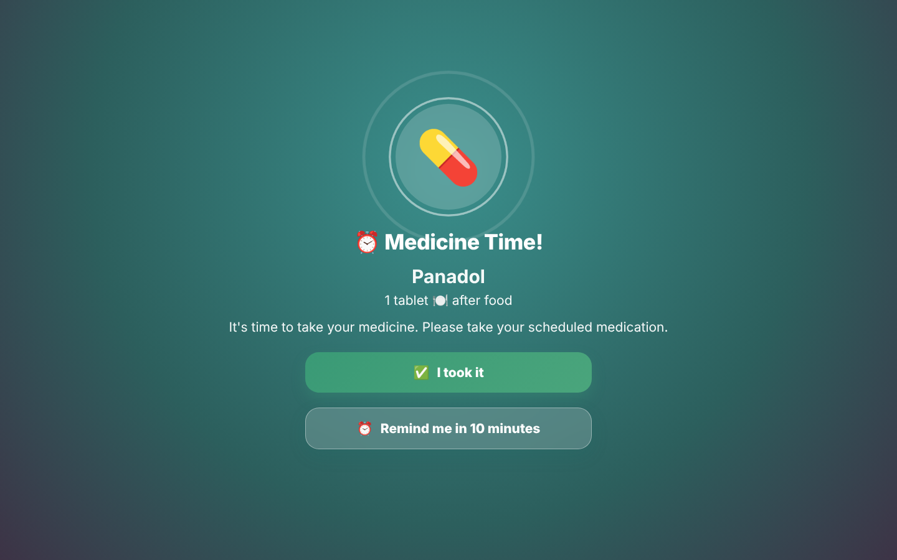 |

| Profile + emergency call | Phone view (full-width menus) |
|---|---|
| 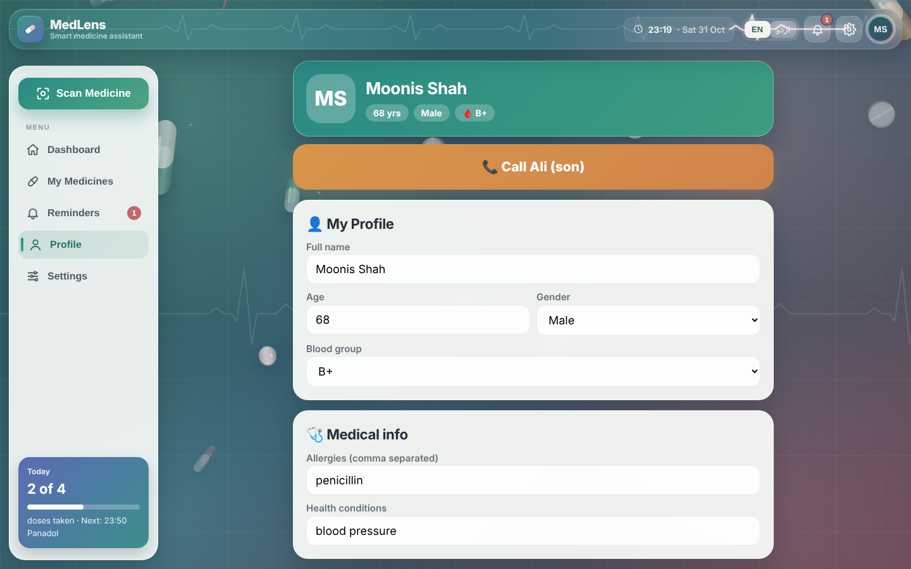 | 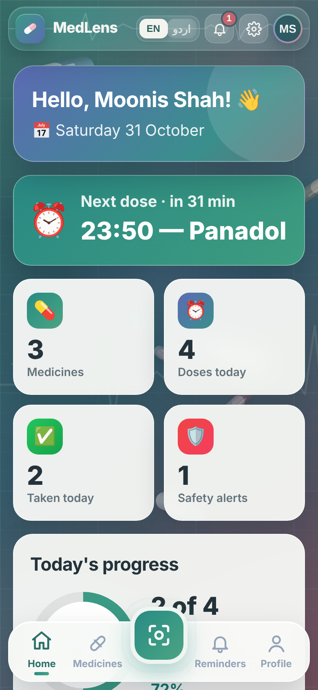 |

**Smart header:** when light cards scroll under the glass top bar, its text and icons turn dark automatically so they stay readable (the heartbeat line turns teal).

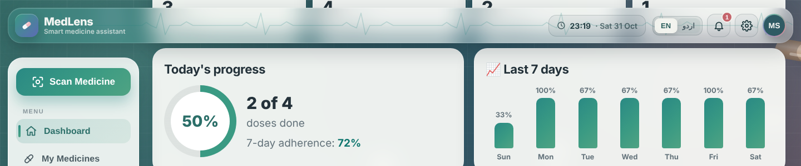

## ✨ Key features

**AI and safety**
- **📷 AI medicine reading** from boxes, strips and handwritten prescriptions.
- **⚠️ "Refuses to guess" safety gate:** low-confidence readings hide the dose and ask the user to confirm with a pharmacist.
- **🚫 Drug-interaction warnings** from a curated, reviewable rule list.
- **♻️ Duplicate-ingredient detection** (for example two brands of paracetamol).
- **🤧 Allergy alerts** based on the patient's profile.
- **✏️ Caregiver confirm and edit** before saving (human in the loop).

**Voice and reminders**
- **🔊 Spoken instructions in English and Urdu**, with a full right-to-left Urdu interface.
- **⏰ Automatic reminders** (default 8:00 AM, 2:00 PM, 9:00 PM), each editable.
- **🔔 Alarm** with sound, vibration, notification and a spoken message that repeats until acknowledged.
- **✅ Taken / ⏰ Snooze 10 min / ❌ Missed** tracking.

**Dashboard and account**
- **📊 Dashboard-first home:** greeting, next-dose countdown, 4 stat tiles, progress ring, 7-day adherence chart, and today's plan with status chips.
- **👤 Profile with PIN login:** age, blood group, allergies, conditions, and a one-tap **emergency call** button.
- **🔒 Privacy first:** photos are never stored; all data stays on the device; PIN stored as a SHA-256 hash.

**Modern interface**
- **🎞️ Animated logo** on the start page: two-tone capsule that floats and opens, rotating rings, a self-drawing heartbeat line, and an orbiting medical cross.
- **🧭 Modern top bar:** sticky, full-width floating glass bar with logo, live clock and date, EN ⇄ اردو switch, bell with an upcoming-dose badge, settings, and an avatar with your initials.
- **💓 Header heartbeat:** a glowing ECG pulse runs along the top bar, one pulse at a time from left to right, like a heart monitor.
- **👁️ Auto-contrast header:** when light cards scroll under the top bar, its text and icons switch to dark colours automatically, without changing the bar's design.
- **🖥️ PC sidebar:** a floating sidebar on the left edge with a big **Scan Medicine** button, the menu (Dashboard, My Medicines, Reminders with badge, Profile, Settings) and a **Today** card showing doses taken and the next dose. In Urdu it moves to the right edge.
- **📱 Phone bottom menu:** a full-width floating menu with Home, Medicines, a raised **Scan** button, Reminders and Profile.
- **🌊 Animated medical background:** floating 3D capsules, tablets and crosses, a glowing ECG heartbeat line, slow aurora lights and soft sparkles.
- **📐 Responsive layout:** on PC the dashboard fills the full width next to the sidebar; on phones and tablets it is a single column with full-width top and bottom menus.

## 🎨 Design and user experience

MedLens is designed for older eyes and long daily use.

| Principle | How it is applied |
|---|---|
| **Eye comfort** | Calm palette of muted teal and dusty rose, no neon or bright red. Cards are off-white instead of pure white to reduce glare. |
| **Readability** | Large text and buttons, dark slate text on light cards, high contrast for all important information. |
| **Gentle motion** | All animations are slow and soft. Pills drift, the aurora moves over 30–50 seconds, and glows are subtle. |
| **Accessibility** | If the device has "reduce motion" turned on, the animations stop automatically. |
| **Clean focus** | Background pills stay away from the centre of the start and login screens so the logo and text are always clear. |
| **Bilingual** | Every label, the top bar, the menu and the voice switch between English and Urdu (right-to-left). |
| **Smart readability** | The glass top bar keeps its look, but its text and icons turn dark over light content so they are always readable. |
| **Right layout for each device** | PC: floating left sidebar + full-width top bar. Phone/tablet: full-width top bar + full-width bottom menu. Both float with rounded corners and soft shadows. |

**Colour palette**

| Use | Colour |
|---|---|
| Primary teal | `#2A8A84` → `#3A9A83` |
| Background | `#2C5F5D` → `#355D6C` → `#6B4A58` |
| Accent dusty rose | `#C4757C` / `#F2B8C1` |
| Indigo accent | `#5C6BB5` |
| Cards | `#F9FAF7` (off-white) |
| Text | `#24323A` (slate) |
| Warning / danger | `#D9954A` / `#C4656C` |

## ⚙️ How it works

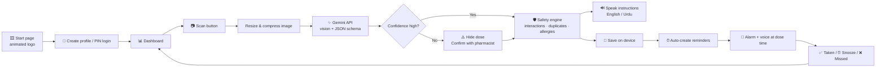

**Design principle:** *Gemini reads, rules decide, the patient confirms.* The AI is only used to read what is printed or written. Every safety warning comes from deterministic, reviewable rules in the code, never from the model's opinion.

## 🏗️ System architecture

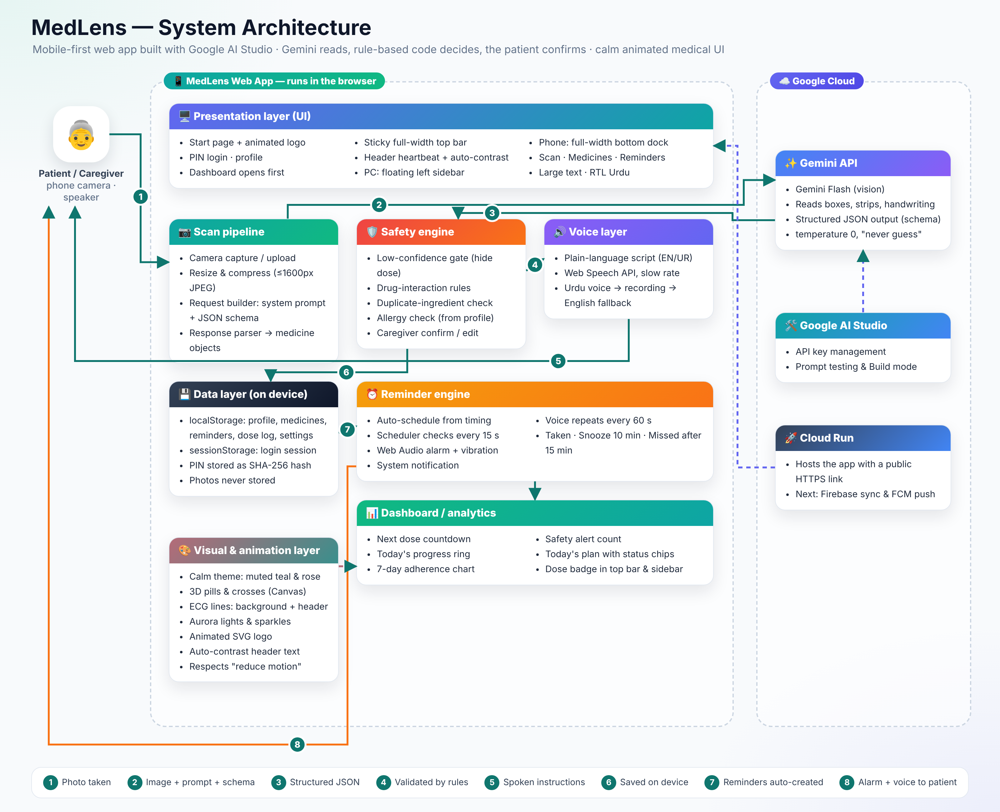

| Layer | Responsibility |
|---|---|
| **Presentation (UI)** | Start page with animated logo, login and profile, dashboard-first home, sticky full-width top bar with heartbeat and auto-contrast text, floating left sidebar on PC, full-width bottom menu on phones, scan results, medicines, reminders, alarm popup; English ⇄ Urdu |
| **Scan pipeline** | Camera capture, image compression, Gemini request (system prompt + JSON schema), response parsing |
| **Safety engine** | Low-confidence gate, interaction rules, duplicate check, allergy check, caregiver confirmation |
| **Voice layer** | Plain-language scripts, Web Speech API, Urdu voice → recorded Urdu audio → English fallback |
| **Reminder engine** | Auto-scheduling, 15-second scheduler, Web Audio alarm, notifications, repeating voice, snooze, missed |
| **Dashboard / analytics** | Next-dose countdown, progress ring, 7-day adherence, safety alert count, today's plan, dose badge in the top bar and sidebar, sidebar "Today" card |
| **Data layer** | `localStorage` (profile, medicines, reminders, dose log, settings), `sessionStorage` (login), SHA-256 PIN hash |
| **Visual & animation layer** | Calm theme, 3D pills and crosses (Canvas 2D), ECG heartbeat in the background and the top bar (SVG + Web Animations API), aurora and sparkles (CSS), animated SVG logo, auto-contrast header text, reduce-motion support |
| **Google Cloud** | Gemini API (reading), Google AI Studio (key + prompt testing), Cloud Run (hosting) |

## 🗃️ Data model (ERD)

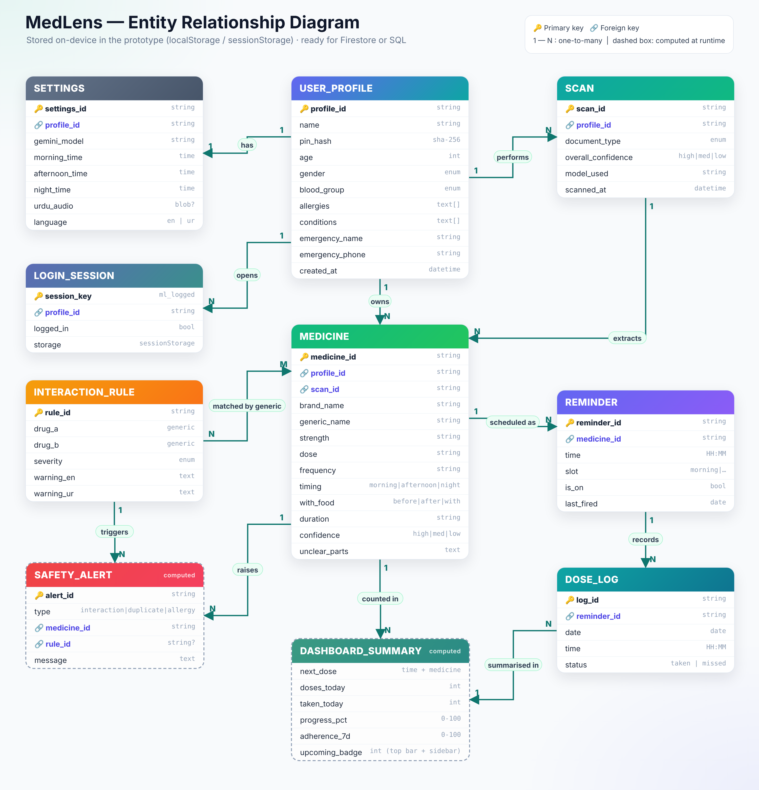

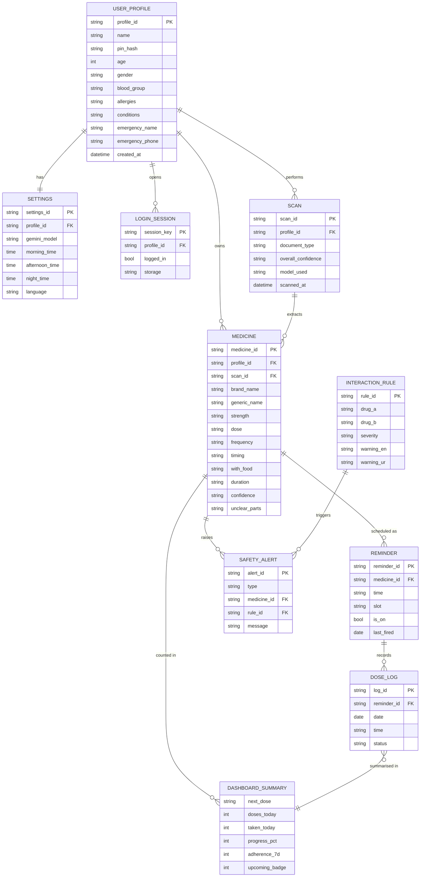

> In the prototype these entities are stored as JSON in the browser. `SAFETY_ALERT` and `DASHBOARD_SUMMARY` are computed at runtime and never stored; `DASHBOARD_SUMMARY` feeds the dashboard, the sidebar "Today" card and the top-bar badge. `LOGIN_SESSION` lives in `sessionStorage`, so closing the browser logs the user out. The same model maps directly to Firestore or a SQL database for the cloud version.

## 🧰 Technology stack

| Area | Technology |
|---|---|
| AI model | **Google Gemini Flash** (multimodal vision) via the Gemini API |
| AI output | Structured output (`responseMimeType: application/json` + `responseSchema`), temperature 0 |
| Development | **Google AI Studio** (API key, prompt testing, Build mode) |
| Frontend | HTML5, CSS3 (glassmorphism, gradients, keyframe animations), vanilla JavaScript |
| Animation | Canvas 2D (3D pills), SVG + Web Animations API (heartbeat lines, logo), CSS (aurora, sparkles) |
| Layout & readability | CSS Grid / Flexbox, media queries (PC sidebar vs phone menu), `ResizeObserver`, `document.elementsFromPoint` (auto-contrast header) |
| Voice | Web Speech API (`speechSynthesis`), optional recorded Urdu audio |
| Alarm | Web Audio API, Notifications API, Vibration API |
| Storage | `localStorage`, `sessionStorage` |
| Security | Web Crypto API (SHA-256 PIN hashing) |
| Fonts | Plus Jakarta Sans, Noto Nastaliq Urdu |
| Hosting | Google Cloud Run (from AI Studio) or any static host |

## 🚀 Getting started

### Prerequisites

- A Google account
- A **Gemini API key** from [Google AI Studio](https://aistudio.google.com/apikey)
- Google Chrome (desktop or Android)

### Option A: Run locally

1. Download `index.html` (the complete app in one file).
2. Open it in **Google Chrome**.
3. Tap **Start MedLens**, create your profile, then open **⚙️ Settings** in the top bar and paste your Gemini API key.

### Option B: Run in Google AI Studio

1. Open **Google AI Studio → Build** and open (or create) an app.
2. Click **`< >`** (code view) and open `index.html`.
3. Replace its contents with the MedLens code.
4. If the project has `index.tsx`, replace its contents with `export {};`.
5. Save, click **Preview**, then **Deploy App** to get a public link.

### Project structure

```
medlens/
├── index.html            # Complete app: UI, scan pipeline, safety engine, voice,
│                         # reminders, dashboard, profile & login, animations
├── README.md             # This file
├── architecture.png      # System architecture diagram
├── erd.png               # Entity relationship diagram
└── screenshots/          # App screenshots used in this README
```

## 📱 Using the app

1. **Start** → watch the animated logo, then tap *Start MedLens* (unlocks sound and voice).
2. **Login** → create a profile with your name and a 4-digit PIN, or enter your PIN. The **dashboard** opens.
3. **Top bar** → see the time, switch **EN ⇄ اردو**, tap the 🔔 bell (badge = doses left today), ⚙️ settings, or your avatar for the profile.
4. **Navigate** → on PC use the left **sidebar**; on a phone use the **bottom menu**.
5. **Scan** → tap **Scan Medicine** (sidebar) or the raised Scan button (phone), photograph a medicine, check the card, tap **🔊 Listen**, edit if needed, then **Save**.
6. **Medicines** → see the daily schedule and any red safety warnings.
7. **Reminders** → times are created automatically; change them anytime. Use **🔔 Test Alarm** to try it.
8. **Profile** → add age, blood group, allergies, conditions and an emergency contact.

## 🛡️ Responsible AI and safety

| Risk | How MedLens handles it |
|---|---|
| AI misreads a medicine | Strict prompt ("only report what is visible, never guess"), temperature 0, and a **confidence level per medicine** |
| Wrong dose shown | Low-confidence readings **hide the dose** and show *"Please confirm with your pharmacist"* |
| AI gives medical advice | The AI only extracts text. **All warnings come from rule-based code** that a pharmacist can review |
| No human check | **Caregiver edit and confirm** step before saving |
| Privacy | Photos are sent only for reading and **never stored**; all records stay on the device; PIN stored as a SHA-256 hash |
| Language exclusion | Full English and Urdu interface and voice |
| Eye strain / motion sensitivity | Calm palette, off-white cards, slow animation, and automatic **reduce-motion** support |
| Over-reliance | A disclaimer on every screen: MedLens does not replace a doctor or pharmacist |

## 📏 Evaluation

We evaluate MedLens on a test set of real medicine photos (boxes, strips, and prescriptions, including blurry and handwritten ones).

| Metric | What it measures |
|---|---|
| Name accuracy (printed) | % of medicine names read correctly from packaging |
| Name accuracy (handwritten) | % read correctly from prescriptions |
| Dose and frequency accuracy | % of doses and frequencies read correctly |
| **Uncertainty catch rate** | % of wrong readings that were correctly flagged as low confidence |
| Interaction detection | % of known interacting pairs that raised a warning |
| Reminder reliability | % of scheduled alarms that fired on time while the app was open |

> Fill in your results here before submission. The **uncertainty catch rate** is our key safety metric: when the AI is wrong, it should usually know it is wrong.

## 🌍 Real-world impact

- **Elderly patients** managing several medicines independently.
- **People with low literacy** or who don't read the language on the packaging.
- **Caregivers and families** who want to know whether a parent took their medicine.
- **Rural clinics and pharmacies** with limited time to explain every prescription.

## ⚠️ Limitations

- Alarms ring only while the app is open in the browser (web apps cannot ring when closed or when the phone is locked).
- Urdu speech depends on the device having an Urdu voice; otherwise a recorded Urdu message or English is used.
- The interaction list is a small curated set for demonstration, not a complete drug database.
- Login and data are stored on one device only; there is no cloud sync yet.
- The Gemini API key is entered in the app and stored in the browser; production use needs a backend proxy.
- Background animations use some battery on older phones; they pause when the tab is hidden and stop with "reduce motion".

## 🛣️ Roadmap

- [ ] Android app (Flutter) so alarms work when the phone is locked
- [ ] Firebase Authentication and Firestore cloud sync
- [ ] Caregiver mode: family receives a notification when a dose is missed
- [ ] Pharmacist-reviewed local brand database and larger interaction list
- [ ] Gemini TTS for natural voices in more regional languages (Pashto, Punjabi, Sindhi)
- [ ] Light/dark theme switch and a "simple mode" with animations off
- [ ] Offline mode with an on-device model
- [ ] Pharmacy and clinic partnerships

## 👥 Team

| Name | Role |
|---|---|
| _Your name_ | AI and prompt engineering, evaluation |
| _Team member_ | Frontend, UI and animation |
| _Team member_ | Data, research and pitch |

## 📄 Disclaimer

MedLens helps people understand their medicines. **It does not replace a doctor or pharmacist.** Always confirm medicine instructions with a qualified healthcare professional.

---

<p align="center">Built with ❤️ using <b>Google AI Studio</b> and the <b>Gemini API</b></p>
